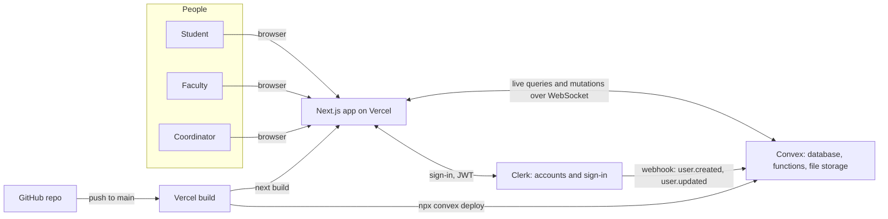
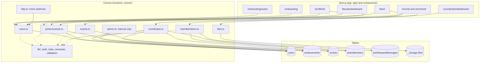
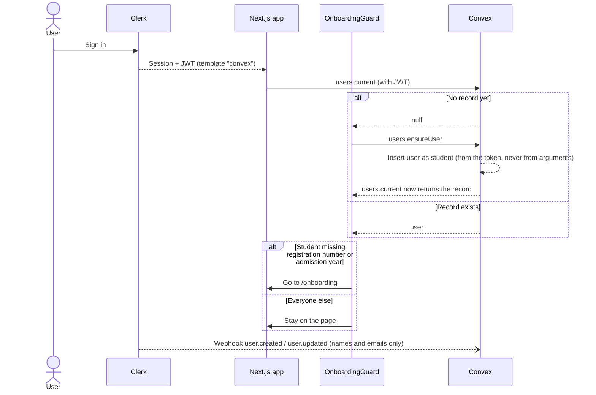
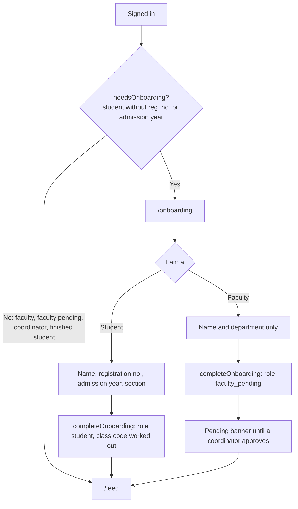
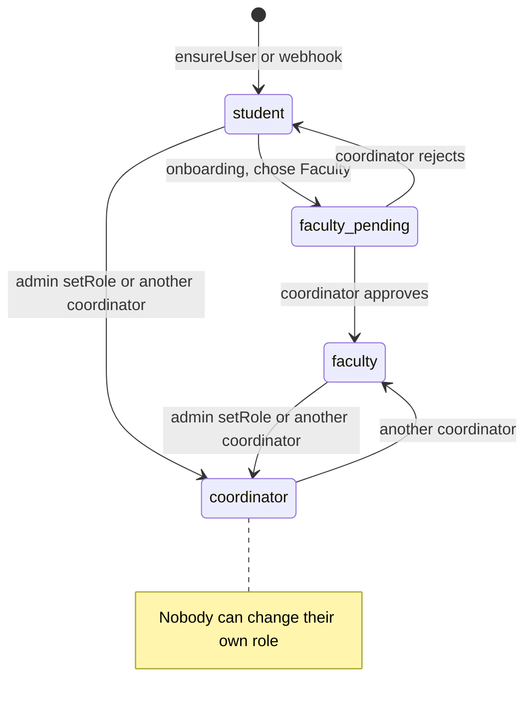
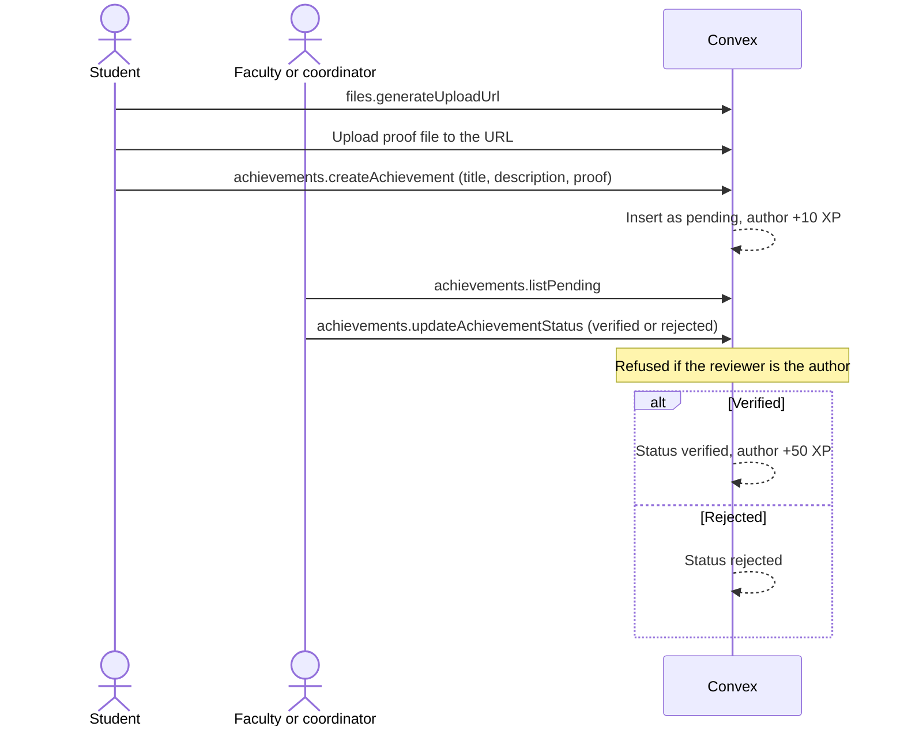
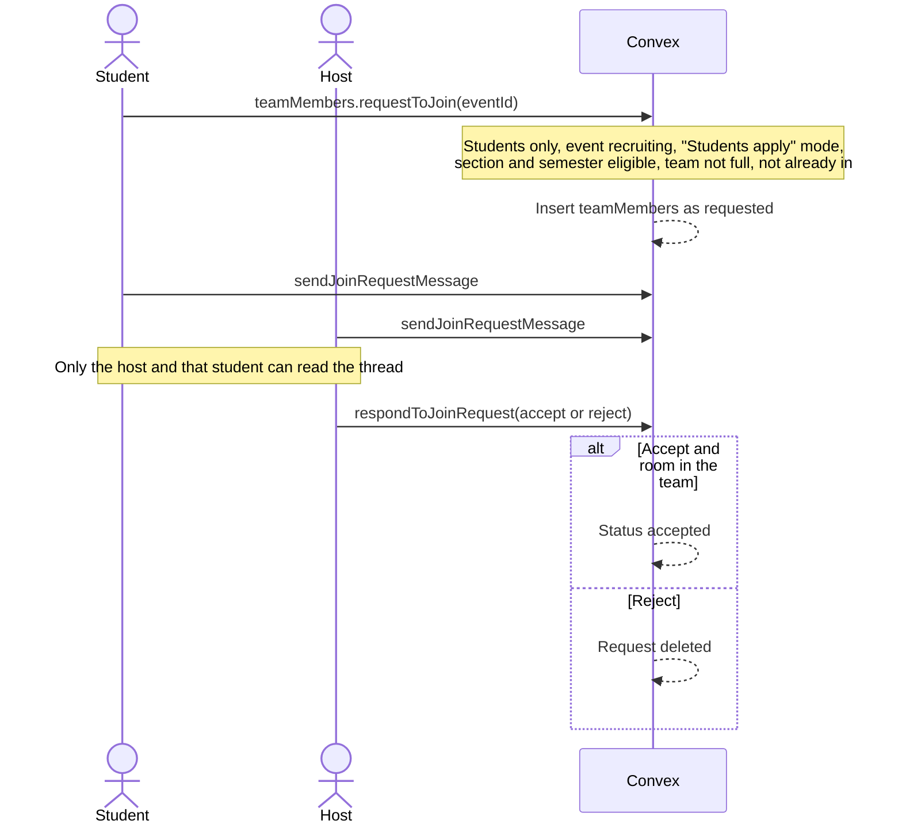
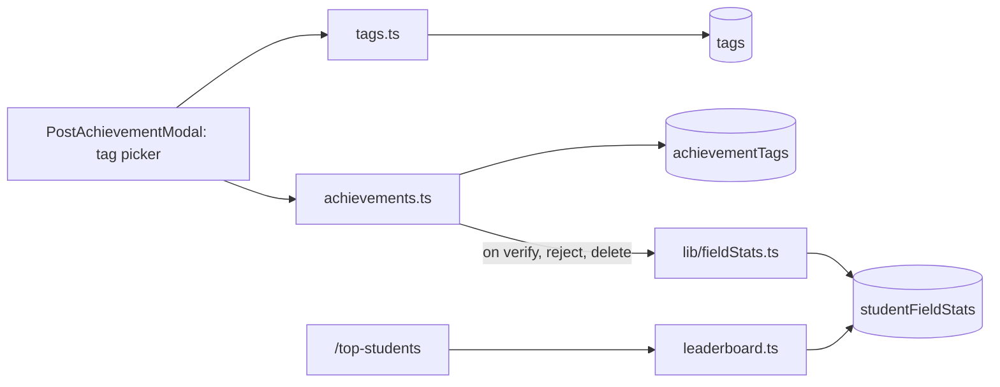

# Architecture

## Stack

| Layer | Choice | Notes |
| --- | --- | --- |
| Frontend | Next.js 15 (App Router), React 19, Tailwind CSS 3 | Almost every page is a client component that reads live data |
| Backend and database | Convex | Queries, mutations, file storage, one HTTP route |
| Auth | Clerk | Development instance, shared by the live QA site and local dev |
| Hosting | Vercel (Hobby) | Deploys from `main` |
| Tests | Vitest + convex-test | `convex/security.test.ts`, 36 tests |

## System context

Who and what Synapse talks to.

## How the pieces connect

1. The visitor signs in with Clerk, which issues a JWT from its `convex` template.
2. The browser talks **directly** to Convex (`ConvexProviderWithClerk` in `app/ConvexClientProvider.tsx`). The Next.js server doesn't proxy data.
3. Every Convex function finds the caller from the token: `ctx.auth.getUserIdentity().subject` is the Clerk user ID, looked up with `getCurrentUser` in `convex/lib/auth.ts`. **Identity never comes from function arguments.**
4. On first sign-in, `users.ensureUser` creates a student record if the webhook hasn't yet.
5. The Clerk webhook (`convex/http.ts`, verified with Svix) keeps names and emails in sync. It never touches roles.

## Components

Which pages use which backend modules, and which tables those modules own.

`convex/lib/` is imported by both the backend and the frontend, so role rules (`roles.ts`) and class codes (`semester.ts`) are worked out the same way everywhere.

## Sign-in and first load

## Onboarding by role

## Roles over time

## Post and verify an achievement

## Join a team

In "Host assigns" mode, students can't ask. The host picks from `listEligibleStudents` and calls `assignStudent`.

## Planned for Sprint 1 (not built yet)

See **Spec: Tags** and **Spec: Top Students by Field**. New tables `tags`, `achievementTags` and `studentFieldStats`, new modules `tags.ts` and `leaderboard.ts`, and a `/top-students` page.

## Guards

| Where | What it does |
| --- | --- |
| `middleware.ts` (Clerk) | Sends signed-out visitors to `/sign-in`. Public: `/sign-in`, `/sign-up`, `/api/dev-login` (404 outside local dev) |
| `components/OnboardingGuard.tsx` | Creates a missing record, and sends students without academic details to `/onboarding` |
| Each page | Shows a "not for you" screen when the role doesn't fit |
| Each Convex function | The real check. Pages only hide things; the server refuses them |

## Security rules

- Role checks happen in Convex functions, using `convex/lib/roles.ts`.
- Private details (email, registration number) only go to the owner and coordinators. Feeds and events never include emails or Clerk IDs.
- Operator tools (`admin:*`) are internal functions, callable only from the Convex dashboard or command line.
- Errors meant for users are `ConvexError`. Production hides the text of any other error.
- Security bugs are reported privately (`SECURITY.md`), never in a public issue.

## Repo layout

| Path | Contents |
| --- | --- |
| `app/` | Pages (App Router) and `api/dev-login` |
| `components/` | Shared UI |
| `convex/` | Schema and server functions |
| `convex/lib/` | Shared auth, roles, semester and validators (also imported by the frontend) |
| `lib/errors.ts` | Turns Convex errors into user-facing messages |
| `scripts/seed-qa-users.mjs` | Creates QA accounts in Clerk and Convex |
| `docs/qa/` | Tester guide and test plan |
| `public/landing/` | The sign-in page photo |
| `app/fonts/` | Self-hosted Cormorant Garamond |
