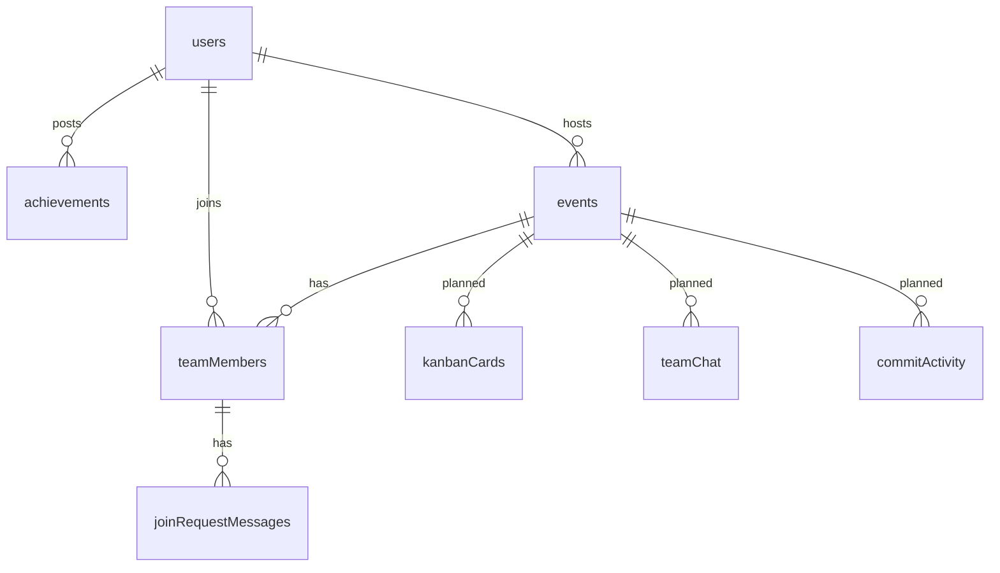

# Data Model

Defined in `convex/schema.ts`. Every document also has Convex's own `_id` and `_creationTime`.

## users

One per person.

| Field | Type | Notes |
| --- | --- | --- |
| clerkId | string | Clerk user ID; index `by_clerkId` |
| name | string | |
| email | string | From Clerk; index `by_email` |
| role | student, faculty_pending, faculty, coordinator | index `by_role` |
| section | IT, IoT, CSE | Department for faculty; index `by_section` |
| registrationNumber | string, optional | Students only |
| universityEmail | string, optional | |
| admissionYear | number, optional | Students only |
| semesterOverride | number 1 to 8, optional | Students only |
| year | number, optional | Deprecated; replaced by the computed semester |
| requestedRole | string, optional | What they chose at onboarding |
| skills | string[] | |
| bio | string, optional | |
| xp | number | |
| createdAt | number | |

## achievements

| Field | Type | Notes |
| --- | --- | --- |
| userId | users id | Author; indexes `by_userId`, `by_userId_status` |
| title, description | string | |
| proofStorageId | storage id, optional | Uploaded image or PDF |
| proofFileUrl | string, optional | External link instead of an upload |
| status | pending, verified, rejected | index `by_status` |
| verifiedBy | users id, optional | Who reviewed it |
| createdAt | number | |

## events

| Field | Type | Notes |
| --- | --- | --- |
| hostId | users id | index `by_hostId` |
| hostType | student, faculty | `faculty` when the host is faculty or a coordinator |
| title, description | string | |
| techStack | string[] | |
| formationMode | student_choice, faculty_assign | "Students apply" or "Host assigns" |
| eligibilityFilter | all, IT, IoT, CSE | index `by_eligibilityFilter` |
| eligibleSemesters | "all" or number[], optional | |
| teamSizeCap | number | Includes the host |
| deadline | number | Timestamp |
| status | recruiting, in_progress, completed | index `by_status` |
| githubRepoUrl | string, optional | |
| createdAt | number | |

## teamMembers

Membership and join requests in one table.

| Field | Type | Notes |
| --- | --- | --- |
| eventId | events id | indexes `by_eventId`, `by_eventId_userId` |
| userId | users id | index `by_userId` |
| role | string | "Project Lead", "Faculty Mentor", or what the student asked for |
| status | requested, accepted | A rejected request is deleted |
| githubUsername | string, optional | Set by the member |

## joinRequestMessages

Chat between the host and an applicant before accepting.

| Field | Type |
| --- | --- |
| teamMemberId | teamMembers id (index) |
| senderId | users id |
| message | string |
| createdAt | number |

## Planned tables (no features yet)

| Table | For |
| --- | --- |
| kanbanCards | Team task board: eventId, title, assignedTo, status (todo, inprogress, done) |
| teamChat | Team chat: eventId, senderId, message, isAiMessage |
| commitActivity | GitHub activity: eventId, githubUsername, commitSha, filesChanged, additions, deletions |

## Relationships

