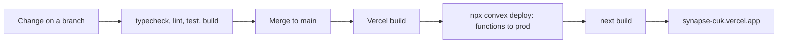

# Environments and Deployment

## Environments

| | Live QA site | Local development |
| --- | --- | --- |
| URL | https://synapse-cuk.vercel.app | http://localhost:3000 |
| Convex | prod `rugged-ibex-10` | dev `lovable-cricket-792` |
| Clerk | Development instance | Same instance |
| Data | Real QA data. Never wipe it | Test data. Can be reset |
| Test logins | Email + password from your private rows; code `424242` | One-click buttons on the sign-in page |

The two databases are separate on purpose. Anything you create locally won't appear on the live site, and the reverse is also true.

## How a change ships

- `vercel.json` sets the build to `npx convex deploy --cmd 'npm run build'`, so backend and frontend ship together.
- Only `main` builds; other branches are skipped.
- `main` has branch rules (pull request plus 2 status checks). Admin pushes currently bypass them; see Linear.
- A deploy takes about a minute. Check it in the Vercel dashboard or with `npx vercel ls`.

## Rolling back

In Vercel, open the previous good deployment and choose **Promote to Production**. Convex functions roll back on the next deploy of the old code: revert the commit on `main` and push.

## Environment variables

`.env.local` is never committed. Copy `.env.example` and fill it in.

| Variable | Set in | Purpose |
| --- | --- | --- |
| NEXT_PUBLIC_CONVEX_URL, NEXT_PUBLIC_CONVEX_SITE_URL, CONVEX_DEPLOYMENT | `.env.local`, Vercel | Which Convex deployment |
| NEXT_PUBLIC_CLERK_PUBLISHABLE_KEY, CLERK_SECRET_KEY | `.env.local`, Vercel | Clerk |
| NEXT_PUBLIC_CLERK_SIGN_IN_URL and friends | `.env.local`, Vercel | Clerk routes |
| CONVEX_DEPLOY_KEY | Vercel | Lets the build deploy Convex prod |
| CLERK_JWT_ISSUER_DOMAIN | Convex env (both) | Verifies Clerk tokens |
| CLERK_WEBHOOK_SECRET | Convex env (both) | Verifies the webhook |
| ALLOWED_EMAIL_DOMAIN | Convex env | Only logs a warning today |
| ALLOW_DATA_RESET | Convex env, **dev only** | Allows `admin:resetAllData` |

Set Convex variables with `npx convex env set NAME value` (add `--prod` for the live site).

## Accounts and dashboards

| Service | What's there |
| --- | --- |
| Vercel | Project `synapse-cuk`, deployments, logs, env vars |
| Convex | Project `synapse`: data, functions, logs, env vars for both deployments |
| Clerk | Users, JWT template `convex`, webhook to `/clerk-users-webhook` |
| GitHub | `Synapse-CUK/synapse`: code, issues, CI |
