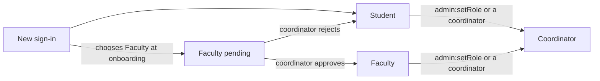

# Product and Roles

> This page describes the app with the roles fix, which is on branch `fix/roles-and-onboarding` and not live yet. Until it merges, the live site still asks faculty for a registration number and doesn't give coordinators faculty powers.

## What Synapse is

A campus network for the CSE, IT and IoT sections: a LinkedIn for students and faculty.

- **Students** post achievements with a certificate or photo as proof and earn XP.
- **Faculty** verify achievements, which gives the student a bonus.
- **Anyone** can host a project or hackathon. Students ask to join, or the host assigns them.
- **Coordinators** run the platform.

## Features

| Area | What it does | Status |
| --- | --- | --- |
| Sign-in and onboarding | Clerk sign-in, then a short setup that depends on your role | Done |
| Profiles | Name, section or department, bio, skills, XP, achievements | Done |
| Achievements feed | Post with an image or PDF proof; everyone sees pending and verified posts | Done |
| Verification queue | Faculty and coordinators verify or reject (+50 XP) | Done |
| Projects and hackathons | Create, search, filter by status, "My teams" view | Done |
| Teams: students apply | Ask to join with a role; host accepts or rejects; chat before accepting | Done |
| Teams: host assigns | The host picks eligible students directly | Done |
| Eligibility | Events can be limited to a section and to semesters | Done |
| Coordinator dashboard | Overview stats, faculty approvals, users, events, achievements | Done |
| Kanban, team chat, GitHub activity | Tables exist | Planned |
| Social features (follow, endorse) | | Deferred until after QA |

## Roles

| Role | Can do | Onboarding asks for |
| --- | --- | --- |
| Student | Post achievements, join and host teams | Name, section, registration no., admission year |
| Faculty (pending) | Browse the feed and projects until a coordinator approves | Name, department |
| Faculty | Verify achievements, faculty dashboard, host events, assign students | Nothing more |
| Coordinator | Everything faculty can, plus the coordinator dashboard | Nothing; granted from Convex or by another coordinator |

**How roles change**

Rules:

- Roles live in Convex, never in Clerk. Nothing a user can edit in Clerk changes their role.
- Nobody can make themselves a coordinator, and a coordinator can't change their own role.
- Only students have a semester and class code, and only students join teams.

## Class codes

Semester + `BT` + section, for example `3BTCSE`, `5BTIT`, `1BTIOT`.

- The semester comes from the admission year. It moves up on **15 November** (odd to even) and **15 April** (even to the next odd).
- A student can set a semester override from 1 to 8 for a late entry or a repeated semester.

## XP

| Action | XP |
| --- | --- |
| Post an achievement | +10 |
| Achievement verified | +50 |

An achievement is reviewed once, and never by its own author.

## User journeys

**Student**
1. Signs in, completes onboarding (section, registration no., admission year), gets a class code.
2. Posts an achievement with proof. Gets +10 XP; it shows as "In review".
3. Browses projects, asks to join one with a role, chats with the host, gets accepted.
4. Sees +50 XP when faculty verify the achievement.

**Faculty**
1. Signs in, chooses Faculty, gives name and department. Sees a "waiting for approval" banner.
2. After approval, gets the Faculty link: the verification queue.
3. Hosts an event in "Host assigns" mode and picks eligible students.

**Coordinator**
1. Is made coordinator with `admin:setRole`.
2. Approves faculty requests, manages users and roles, deletes spam, watches stats.
3. Can do everything faculty can.
