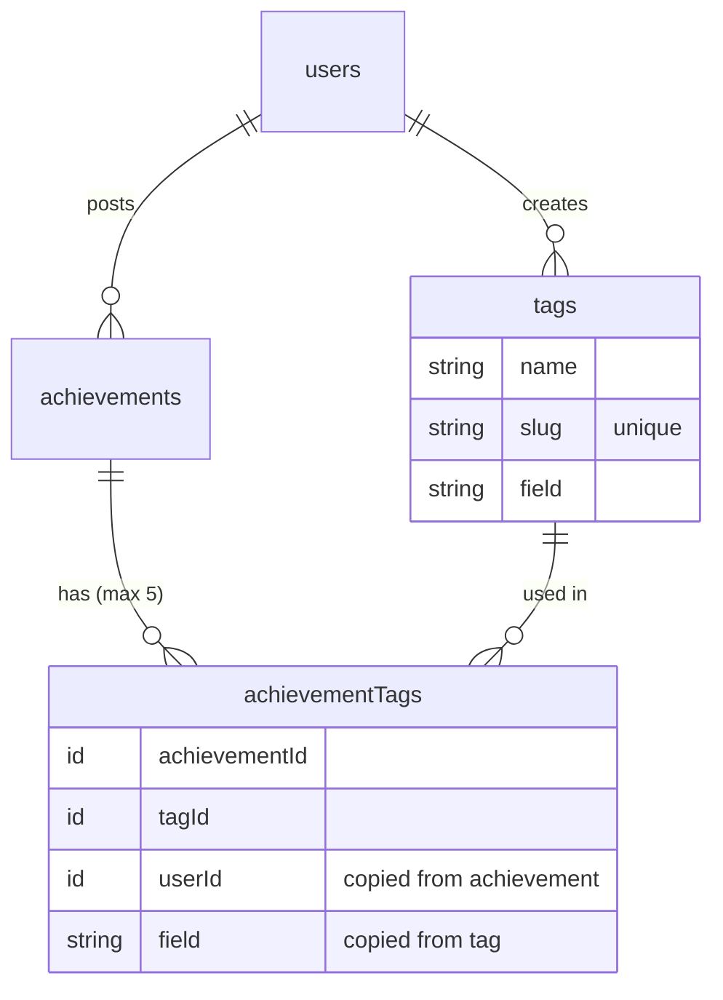

# Spec: Tags

**Sprint 1, Task 1.** Team A. Linear issues T1.1 to T1.7. Status: **spec, not built.**

## The problem

Achievements are free text, so nobody can ask "who has done IoT work?" or "show me every React project". Tags fix that, and they are what Task 2 (Top students by field) counts.

## What we're building

- When posting an achievement, a student adds **up to 5 tags**, such as `React`, `Arduino` or `TensorFlow`.
- Every tag belongs to exactly **one generic field**, such as Web, IoT & Embedded or AI & ML.
- If a tag doesn't exist yet, the student can create it and choose its field.
- Tags show as chips on achievement cards. Clicking a chip filters the feed to that tag.
- Coordinators tidy the list: rename a tag, move it to another field, or merge duplicates (`reactjs` into `React`).

Not in this sprint: tags on events or profiles, tag suggestions from the description, following a tag.

## Decisions for Amal (by Thursday 5 November)

| Decision | Proposal | Decided |
| --- | --- | --- |
| The generic fields | AI & ML, Web, Mobile, IoT & Embedded, Cloud & DevOps, Data, Security, Design & UX, Competitive Programming, Research, Other | |
| Can students create tags, or only pick? | Students create; coordinators clean up | |
| Most tags per achievement | 5 | |
| Can tags change after posting? | Only by the author, only while pending. After verification the tags are what the reviewer approved | |

## Words

| Word | Meaning |
| --- | --- |
| Field | One of the fixed generic areas above. A code constant, not a table, so the list only changes by a code change |
| Tag | A specific skill or tool, created by users, belonging to one field |
| Slug | The tag's normalised name used for uniqueness: lower case, trimmed, spaces become `-`. `"Next JS "` becomes `next-js` |

## Data model

Fields live in a new `convex/lib/fields.ts`, in the same style as `SECTIONS` in `convex/lib/validators.ts`. The frontend imports it too.

```ts
// convex/lib/fields.ts
export const FIELDS = [
  { id: "ai_ml", label: "AI & ML" },
  { id: "web", label: "Web" },
  // ...the list Amal decides
] as const;
export type Field = (typeof FIELDS)[number]["id"];
export const fieldValidator = v.union(/* v.literal for each id */);
```

Two new tables in `convex/schema.ts`:

```ts
tags: defineTable({
  name: v.string(),        // as shown: "Next.js"
  slug: v.string(),        // unique: "next-js"
  field: fieldValidator,
  createdBy: v.id("users"),
})
  .index("by_slug", ["slug"])
  .index("by_field", ["field"]),

achievementTags: defineTable({
  achievementId: v.id("achievements"),
  tagId: v.id("tags"),
  userId: v.id("users"),   // the achievement's author, copied for Task 2
  field: fieldValidator,   // the tag's field, copied for Task 2
})
  .index("by_achievementId", ["achievementId"])
  .index("by_tagId", ["tagId"])
  .index("by_userId_and_field", ["userId", "field"]),
```



**Why a separate `achievementTags` table instead of an array on the achievement?** Convex can't index inside an array, so "every achievement with tag X" and "every tag a student used in field Y" would mean reading every achievement. One row per achievement-tag pair gives both an index.

**Why copy `userId` and `field` onto each row?** Task 2 reads by student and field with one index. Anything that changes a tag's field must update those copies (see Coordinator tools).

## Backend

New module `convex/tags.ts`, plus changes to `achievements.ts` and `coordinator.ts`.

| Function | Type | Who | Does |
| --- | --- | --- | --- |
| `tags.search({ prefix })` | query | Signed in | Up to 10 tags whose slug starts with the prefix. Use an index range on `by_slug`, not a scan |
| `tags.listByField({ field })` | query | Signed in | Up to 100 tags in a field, for browsing |
| `tags.create({ name, field })` | mutation | Students and faculty who finished onboarding | Normalises the slug. If the slug exists, returns the existing tag instead of making a duplicate |
| `achievements.createAchievement` | mutation | Existing | Gains `tagIds: v.optional(v.array(v.id("tags")))`. Writes one `achievementTags` row per tag |
| `achievements.setTags({ achievementId, tagIds })` | mutation | Author only, while pending | Replaces the tags |
| `listFeed`, `listByUser`, `listPending` | queries | Existing | Each achievement comes back with `tags: { _id, name, slug, field }[]` |
| `achievements.listByTag({ slug })` | query | Signed in | Same shape and visibility as `listFeed` (no rejected items), newest first, at most 50 |
| `tags.rename`, `tags.setField`, `tags.merge` | mutations | Coordinators | See below |

### Rules the server enforces

Throw `ConvexError` with a readable message for each:

- Tag name 1 to 30 characters after trimming. Slug allows `a-z 0-9 + # . -` only, so `C++`, `C#` and `Node.js` work.
- At most 5 tags per achievement. Duplicates in `tagIds` are ignored, not an error.
- Every `tagId` must exist.
- `setTags` only by the author and only while the achievement is pending.
- Who is calling always comes from `getCurrentUser(ctx)`, never from an argument.
- No unbounded `.collect()`. Every read uses an index and `.take(n)`.

### Coordinator tools

| Function | Does | Watch out |
| --- | --- | --- |
| `tags.rename({ tagId, name })` | New name and slug | Refuse if the new slug belongs to another tag; suggest merge instead |
| `tags.setField({ tagId, field })` | Moves the tag to another field | Update `field` on every `achievementTags` row for that tag, and tell Task 2's stats to recompute for the affected students. Many rows: do it in batches with `ctx.scheduler.runAfter` |
| `tags.merge({ fromTagId, intoTagId })` | Every use of `from` becomes `into`, then `from` is deleted | An achievement that had both keeps one row. Batch as above |
| `coordinator.deleteAchievement` | Existing | Must also delete that achievement's `achievementTags` rows and update Task 2's stats |

## Frontend

| Where | Change |
| --- | --- |
| `components/PostAchievementModal.tsx` | A tag picker under the description. Type to search (`tags.search`), pick with mouse or keyboard, chips with a remove button, "Create tag 'xyz'" with a field picker when there's no match. Stops at 5 with a short note |
| `components/AchievementCard.tsx` | Tag chips under the description. Each links to `/feed?tag=<slug>` |
| `app/feed/page.tsx` | Reads `?tag=`. Shows "Showing achievements tagged React" with a clear button, and uses `listByTag` |
| `app/coordinator/dashboard/page.tsx` | A new **Tags** tab: tags grouped by field with use counts, rename, change field, merge (pick the tag to keep) |

Use the existing chips, buttons and tokens from **Frontend and Design**. Every list needs loading, empty and error states. Show server errors with `errorMessage()` from `lib/errors.ts`. Check it at phone width.

## Tests (`convex/tags.test.ts`)

- [ ] Creating `"Next JS "` and then `"next js"` gives one tag
- [ ] Bad names are refused (empty, 31 characters, emoji)
- [ ] 6 tags on one achievement is refused; duplicates are collapsed
- [ ] An unknown tag ID is refused
- [ ] Only the author can `setTags`, and only while pending
- [ ] Students and faculty can't rename, move or merge; coordinators can
- [ ] Merge moves every use, keeps one row when an achievement had both, deletes the old tag
- [ ] `setField` updates the copied `field` on every row
- [ ] Deleting an achievement deletes its tag rows
- [ ] `listByTag` never returns rejected achievements

## Done when

- [ ] Everything in "What we're building" works on localhost for student, faculty and coordinator
- [ ] All tests pass (new and the existing 36), plus typecheck, lint and build
- [ ] **Data Model** and **Backend Reference** in this wiki list the new tables and functions
