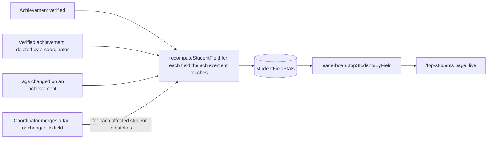

# Spec: Top Students by Field

**Sprint 1, Task 2.** Team B. Linear issues T2.1 to T2.6. Status: **spec, not built.** Needs T1.1 from **Spec: Tags** (the fields list and the `achievementTags` table) first.

## The problem

Faculty forming a team, or a coordinator picking students for a hackathon, want to know: *who are our strongest students in IoT? In AI & ML?* Today the only signal is total XP, which mixes every kind of work.

## What we're building

- A **Top students** page (`/top-students`) with a field picker. For the chosen field it lists students ranked by how much **verified** work they have in it.
- The list updates live: when a faculty member verifies an achievement, the student moves up without anyone refreshing.
- Each row shows rank, name (links to the profile), section and class code, and the score. Nothing private: no email, no registration number.

Not in this sprint: combining fields, time windows ("this semester"), filtering by section, badges.

## Decisions for Amal (by Thursday 5 November)

| Decision | Proposal | Decided |
| --- | --- | --- |
| What a point is | **One verified achievement with at least one tag in the field.** An achievement tagged React and Next.js (both Web) scores 1 for Web, not 2, so adding more tags doesn't inflate the score. The alternative is counting every tag | |
| Pending achievements | Don't count. Only verified ones | |
| Who can see the page | Everyone signed in | |
| Who appears | Students only (not faculty or coordinators) | |

## How the score is kept

Counting from scratch on every page view would read every achievement. Instead, keep a small counter row per student per field and read the top rows with an index.

```ts
// convex/schema.ts
studentFieldStats: defineTable({
  userId: v.id("users"),
  field: fieldValidator,       // from convex/lib/fields.ts (T1.1)
  count: v.number(),           // the score
})
  .index("by_userId_and_field", ["userId", "field"])
  .index("by_field_and_count", ["field", "count"]),
```

### Recompute, don't increment

Write one helper, `recomputeStudentField(ctx, userId, field)` in `convex/lib/fieldStats.ts`. It:

1. Reads that student's `achievementTags` rows for the field (index `by_userId_and_field`, bounded with `.take()`).
2. Loads each distinct achievement and counts the verified ones.
3. Inserts, updates or deletes (when the count is 0) the student's `studentFieldStats` row.

Recomputing gives the same answer however many times it runs, so a missed or doubled event can't leave the count wrong. Adding or subtracting 1 can drift.

### When to call it



| Event | Where it happens | Call |
| --- | --- | --- |
| Achievement verified | `achievements.updateAchievementStatus` | Recompute for the author, for every field in that achievement's tags. (A review is final today: only pending achievements can be verified or rejected, so a rejection never removes points) |
| Achievement deleted | `coordinator.deleteAchievement` | Same, after its `achievementTags` rows are deleted |
| Tags changed | `achievements.setTags` | Same, for old and new fields (pending only today, so normally no change; keep it for safety) |
| Tag merged or moved | `tags.merge`, `tags.setField` (Team A) | For each affected student and field. Agree the hand-off with Team A |

Write the helper first (T2.1) so Team A can call it from their functions.

## Backend

New module `convex/leaderboard.ts`.

| Function | Type | Who | Does |
| --- | --- | --- | --- |
| `leaderboard.topStudentsByField({ field, limit })` | query | Signed in | `limit` 1 to 50, default 20. Reads `by_field_and_count` with `.order("desc").take(limit)`, skips non-students, and returns `{ rank, userId, name, section, classCode, count }` |
| `leaderboard.fieldsForStudent({ userId })` | query | Signed in | That student's non-zero fields and scores, for the profile page (stretch) |
| `leaderboard.backfill` | internal mutation | Amal, from the command line | Walks every `achievementTags` row in pages of 100 and recomputes each student and field it finds, scheduling itself for the next page with `ctx.scheduler.runAfter`. Run once after deploy |

### Rules

- Never return email, registration number or Clerk ID.
- Bounded reads only (`.take()` or pagination). No `.collect()` on any table that grows.
- `rank` is the position in the returned list. Equal scores get the same rank (1, 2, 2, 4).
- `backfill` is internal, so it can't be called from the browser.

## Frontend

| Where | Change |
| --- | --- |
| `app/top-students/page.tsx` (new) | Field picker (tabs on desktop, a select on phones), ranked list, loading skeleton, empty state ("No verified work in Web yet. Post an achievement and tag it.") |
| `components/Navbar.tsx` | A **Top students** link for everyone signed in |
| `app/profile/[userId]/page.tsx` | Stretch: "Strongest fields" chips from `fieldsForStudent` |

Use field labels from `convex/lib/fields.ts`, never hard-coded strings, so a new field appears everywhere at once.

## Tests (`convex/leaderboard.test.ts`)

- [ ] A pending achievement scores nothing; verifying it scores 1 in each of its fields
- [ ] Two tags in the same field on one achievement score 1, not 2
- [ ] Rejecting a pending achievement scores nothing; deleting a verified one takes the point away, and the row disappears at 0
- [ ] Merging a tag or moving it to another field moves the points
- [ ] Results are in descending order and never longer than `limit`; `limit` over 50 is refused
- [ ] No result contains `email`, `registrationNumber` or `clerkId`
- [ ] Faculty and coordinators never appear
- [ ] `backfill` on existing data gives the same numbers as recomputing by hand

## Done when

- [ ] Verify an achievement as faculty in one window and watch the student move on `/top-students` in another
- [ ] All tests pass (new and the existing 36), plus typecheck, lint and build
- [ ] Amal has run `leaderboard:backfill` on prod after the deploy
- [ ] **Data Model** and **Backend Reference** in this wiki list the new table and functions
